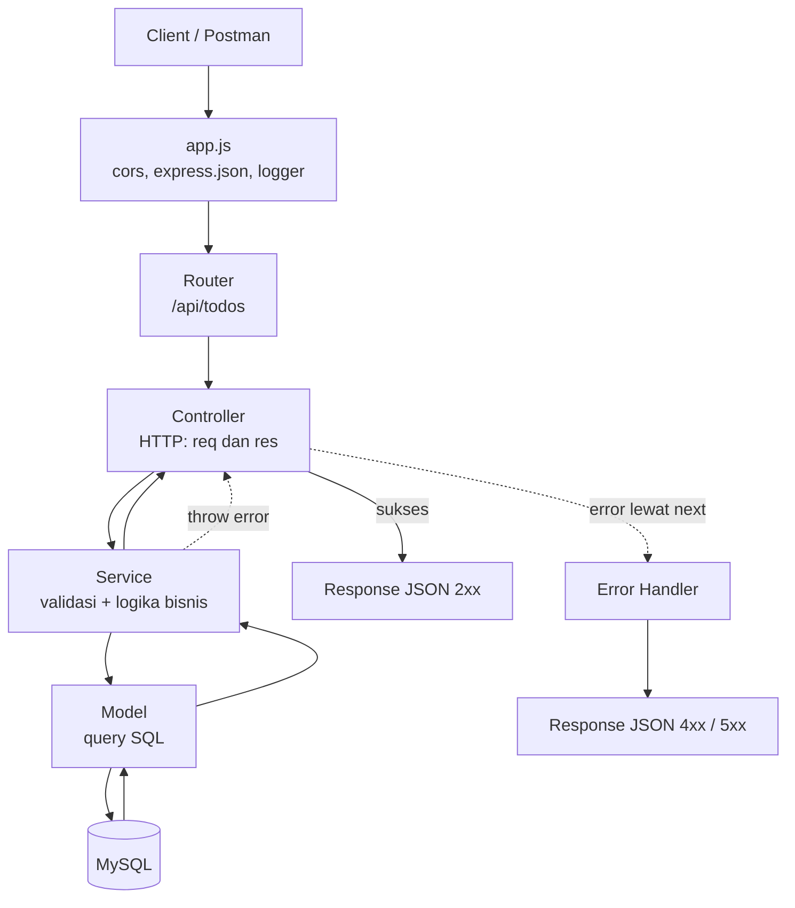
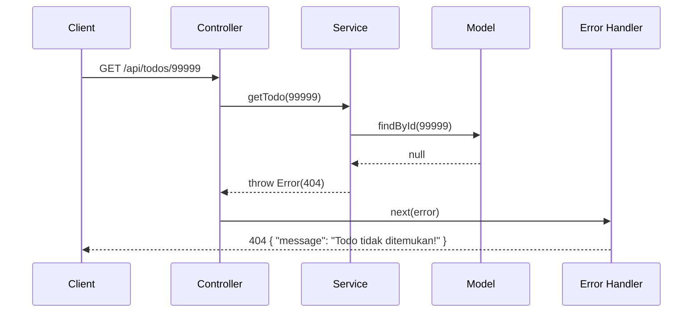

# todolist-express-be

REST API sederhana untuk aplikasi todo list, dibangun dengan **Node.js, Express 5, dan MySQL**. Project ini dibuat sebagai latihan fundamental backend: routing, middleware, layered architecture, error handling, dan koneksi database.

## Daftar Isi

- [todolist-express-be](#todolist-express-be)
  - [Daftar Isi](#daftar-isi)
  - [Fitur](#fitur)
  - [Tech Stack](#tech-stack)
  - [Arsitektur](#arsitektur)
    - [Alur request](#alur-request)
    - [Alur error](#alur-error)
  - [Struktur Folder](#struktur-folder)
  - [Menjalankan Project](#menjalankan-project)
    - [Prasyarat](#prasyarat)
    - [Langkah](#langkah)
    - [Environment variable](#environment-variable)
  - [Database Schema](#database-schema)
  - [API Contract](#api-contract)
    - [Ringkasan endpoint](#ringkasan-endpoint)
    - [Aturan dan validasi](#aturan-dan-validasi)
    - [Status code](#status-code)
    - [Format response](#format-response)
  - [Roadmap dan Rekomendasi Pengembangan](#roadmap-dan-rekomendasi-pengembangan)
    - [Prioritas tinggi](#prioritas-tinggi)
    - [Prioritas menengah](#prioritas-menengah)
    - [Prioritas lanjutan](#prioritas-lanjutan)
    - [Catatan desain yang bisa ditingkatkan](#catatan-desain-yang-bisa-ditingkatkan)
  - [Lisensi](#lisensi)

## Fitur

- CRUD todo (create, read, update, delete)
- Partial update lewat `PATCH` (cukup kirim field yang berubah)
- Layered architecture: router, controller, service, model
- Centralized error handler dengan response JSON yang konsisten
- Request logging (custom middleware)
- Query database aman dari SQL injection (prepared statement)
- Konfigurasi lewat environment variable

## Tech Stack

| Bagian      | Teknologi                              |
| ----------- | -------------------------------------- |
| Runtime     | Node.js (ES Module)                    |
| Framework   | Express 5                              |
| Database    | MySQL                                  |
| Driver DB   | mysql2 (promise pool)                  |
| Middleware  | cors, custom logger, (morgan opsional) |
| Config      | dotenv                                 |
| Dev tool    | nodemon                                |
| API testing | Postman                                |

## Arsitektur

Kode dipisah per lapisan, tiap lapisan punya satu tanggung jawab.

| Lapisan           | Tanggung jawab                                          |
| ----------------- | ------------------------------------------------------- |
| **Router**        | Memetakan URL dan method HTTP ke controller             |
| **Controller**    | Urusan HTTP: baca `req`, panggil service, kirim `res`   |
| **Service**       | Logika bisnis dan validasi. Tidak tahu soal `req`/`res` |
| **Model**         | Akses database (query SQL) saja                         |
| **Error handler** | Satu pintu keluar untuk semua error                     |

### Alur request



### Alur error

Service melempar error yang membawa `status`, controller meneruskannya lewat `next(error)`, lalu error handler mengubahnya menjadi response JSON.



Konvensi return di model:

| Fungsi     | Return                 | Dipakai service untuk  |
| ---------- | ---------------------- | ---------------------- |
| `insert`   | objek todo             | dikembalikan ke client |
| `findAll`  | array todo             | dikembalikan ke client |
| `findById` | objek todo atau `null` | `null` menjadi 404     |
| `update`   | objek todo atau `null` | `null` menjadi 404     |
| `remove`   | `true` / `false`       | `false` menjadi 404    |

## Struktur Folder

> Sesuaikan dengan nama file/folder di repo kamu.

```
todolist-express-be/
├── src/
│   ├── config/
│   │   └── db.js            # koneksi MySQL (pool)
│   ├── database/
│   │   └── schema.sql       # definisi tabel
│   ├── middleware/
│   │   ├── middleware.js    # request logger
│   │   └── errorHandler.js  # centralized error handler
│   ├── models/
│   │   └── model.js         # query ke tabel todolist
│   ├── services/
│   │   └── service.js       # validasi + logika bisnis
│   ├── controllers/
│   │   └── controller.js    # handler HTTP
│   ├── routes/
│   │   └── route.js         # definisi endpoint
│   ├── app.js               # setup express + middleware
│   └── server.js            # app.listen
├── .env.example
├── package.json
└── README.md
```

## Menjalankan Project

### Prasyarat

- Node.js 18+
- MySQL berjalan di lokal

### Langkah

```bash
# 1. clone
git clone https://github.com/<username>/todolist-express-be.git
cd todolist-express-be

# 2. install dependency
npm install

# 3. salin env lalu isi nilainya
cp .env.example .env

# 4. buat database, lalu jalankan src/database/schema.sql

# 5. jalankan
npm run dev     # development (nodemon)
npm start       # production
```

### Environment variable

```env
PORT=3000
DB_HOST=127.0.0.1
DB_PORT=3306
DB_USER=
DB_PASSWORD=
DB_NAME=
```

> Gunakan `127.0.0.1` dan bukan `localhost` jika muncul error `ECONNREFUSED ::1:3306`, karena `localhost` bisa ter-resolve ke IPv6 di beberapa mesin.

## Database Schema

Schema ada di `src/database/schema.sql`:

```sql
CREATE TABLE IF NOT EXISTS todolist (
  id INT AUTO_INCREMENT PRIMARY KEY,
  title VARCHAR(255) NOT NULL,
  description TEXT NULL,
  completed TINYINT(1) NOT NULL DEFAULT 0,
  created_at TIMESTAMP NOT NULL DEFAULT CURRENT_TIMESTAMP
);
```

Catatan: `completed` disimpan sebagai `0/1` di MySQL dan diubah menjadi `false/true` di lapisan model.

## API Contract

Base URL: `http://localhost:3000`

### Ringkasan endpoint

| Method | Endpoint         | Deskripsi           | Request body                                         | Sukses | Error |
| ------ | ---------------- | ------------------- | ---------------------------------------------------- | ------ | ----- |
| POST   | `/api/todos`     | Buat todo           | `title` (wajib), `description`                       | 201    | 400   |
| GET    | `/api/todos`     | Ambil semua todo    | -                                                    | 200    | -     |
| GET    | `/api/todos/:id` | Ambil satu todo     | -                                                    | 200    | 404   |
| PATCH  | `/api/todos/:id` | Ubah todo (parsial) | `title`, `description`, `completed` (semua opsional) | 200    | 404   |
| DELETE | `/api/todos/:id` | Hapus todo          | -                                                    | 204    | 404   |

### Aturan dan validasi

| Field         | Tipe             | Aturan                                                       |
| ------------- | ---------------- | ------------------------------------------------------------ |
| `title`       | string           | Wajib saat create, tidak boleh kosong/spasi saja, maks 255   |
| `description` | string atau null | Opsional                                                     |
| `completed`   | boolean          | Hanya bisa diubah lewat `PATCH`, default `false` saat create |

Aturan lain:

- `title` otomatis di-`trim()` (spasi di pinggir dibuang).
- Pada `POST`, field selain `title` dan `description` diabaikan.
- Pada `PATCH`, field yang tidak dikirim tidak diubah.
- `created_at` dibuat otomatis oleh database (UTC, ISO 8601).

### Status code

| Status | Arti                  | Contoh                                  |
| ------ | --------------------- | --------------------------------------- |
| 200    | OK                    | `GET`, `PATCH` berhasil                 |
| 201    | Created               | `POST` berhasil                         |
| 204    | No Content            | `DELETE` berhasil (tanpa body)          |
| 400    | Bad Request           | `title` kosong atau tidak dikirim       |
| 404    | Not Found             | Todo dengan `id` tersebut tidak ada     |
| 500    | Internal Server Error | Error tak terduga (detail hanya di log) |

### Format response

Response sukses mengembalikan objek todo (atau array untuk `GET /api/todos`):

```json
{
  "id": 1,
  "title": "belajar express",
  "description": "bikin CRUD todo",
  "completed": false,
  "created_at": "2026-10-17T17:09:11.000Z"
}
```

Semua error memakai bentuk yang sama:

```json
{ "message": "Todo tidak ditemukan!" }
```

## Roadmap dan Rekomendasi Pengembangan

Project ini sudah menjalankan fondasi yang benar, tetapi masih ada beberapa hal yang membedakan project belajar dengan kode yang layak produksi. Diurutkan berdasarkan prioritas.

### Prioritas tinggi

- [ ] **Validasi input dengan [zod](https://zod.dev)**
      Saat ini validasi hanya mengecek `title` kosong. Input seperti `title: 123`, array/object, atau title lebih dari 255 karakter bisa menghasilkan error 500, padahal seharusnya 400. Pasang validasi schema sebagai middleware di route, termasuk validasi `:id` (harus integer positif) dan body `PATCH` (minimal satu field).
- [ ] **Pesan error validasi yang detail**
      Kembalikan daftar error per field, misalnya `{ "message": "Validation error", "errors": [{ "field": "title", "message": "..." }] }`.
- [ ] **Handler 404 untuk route tidak dikenal** dalam format JSON, diletakkan sebelum error handler.
- [ ] **Perbaiki penanganan body kosong** pada `PATCH` agar tidak error saat `req.body` tidak terbaca.
- [ ] **Rapikan penamaan file** (`todo.model.js`, `todo.service.js`, dst.) supaya mudah dicari saat project bertambah fitur.
- [ ] **Validasi environment variable saat startup** (gagal cepat jika `DB_*` tidak lengkap), bisa juga dengan zod.

### Prioritas menengah

- [ ] **Pagination dan filter**: `GET /api/todos?completed=true&page=1&limit=10`, lengkap dengan metadata (`total`, `page`, `limit`).
- [ ] **Versioning API**: ubah prefix menjadi `/api/v1/todos`.
- [ ] **Automated test**: Vitest atau `node:test` + supertest untuk service dan endpoint, lalu jalankan di CI.
- [ ] **CI dengan GitHub Actions**: lint dan test otomatis di setiap pull request.
- [ ] **Linter dan formatter**: ESLint + Prettier.
- [ ] **Migrasi database**: ganti pembuatan tabel manual dengan tool migrasi (Knex migrations atau `db-migrate`) agar perubahan schema terlacak di git.
- [ ] **Logging terstruktur**: ganti `console.log` dengan logger seperti `pino`, plus request ID.
- [ ] **Graceful shutdown**: tutup pool database saat proses dihentikan (`SIGTERM`/`SIGINT`).
- [ ] **Kolom `updated_at`** (`ON UPDATE CURRENT_TIMESTAMP`).

### Prioritas lanjutan

- [ ] **Autentikasi JWT**: register, login, dan todo per user (tambah `user_id`, relasi tabel).
- [ ] **Dokumentasi API dengan OpenAPI/Swagger** agar kontrak bisa dilihat dan dicoba interaktif.
- [ ] **Keamanan HTTP**: `helmet` untuk security header, `express-rate-limit` untuk membatasi request, konfigurasi CORS yang lebih ketat (whitelist origin).
- [ ] **Docker**: `Dockerfile` dan `docker-compose.yml` (app + MySQL) agar setup satu perintah.
- [ ] **Health check endpoint** yang ikut mengecek koneksi database.
- [ ] **Pertimbangkan ORM/query builder** (Prisma, Drizzle, atau Knex) setelah paham SQL dasarnya.
- [ ] **Soft delete** jika data perlu bisa dipulihkan.
- [ ] **Deploy** (Railway, Render, atau VPS) dengan environment production.

### Catatan desain yang bisa ditingkatkan

- Error saat ini dibuat lewat helper sederhana (`createError`). Bisa dikembangkan menjadi class `AppError` agar lebih konsisten dan mudah dibedakan dari error tak terduga.
- `PATCH` memakai `COALESCE`, sehingga kolom `description` tidak bisa dikosongkan kembali ke `NULL`. Jika dibutuhkan, bedakan antara field "tidak dikirim" dan "sengaja dikosongkan".
- `created_at` dikembalikan dalam UTC. Konversi zona waktu sebaiknya dilakukan di sisi client.

## Lisensi

ISC
